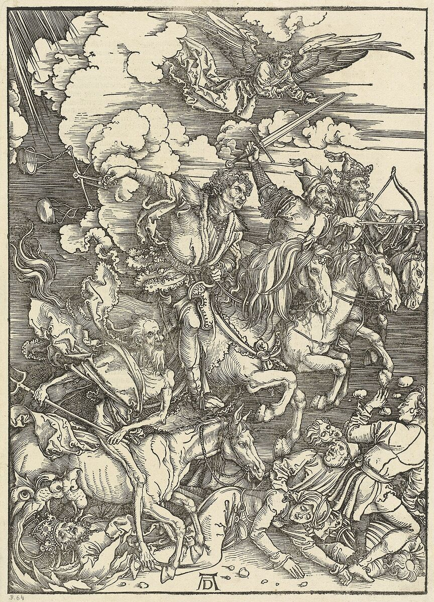
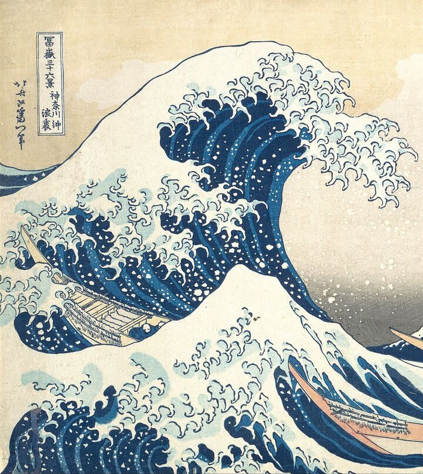
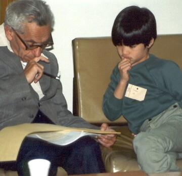
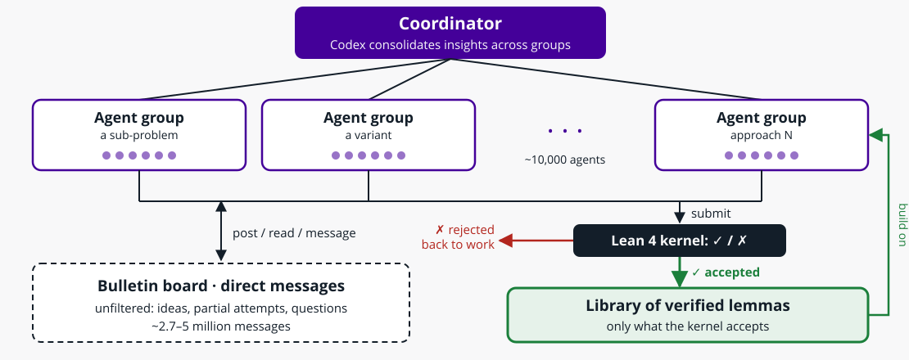
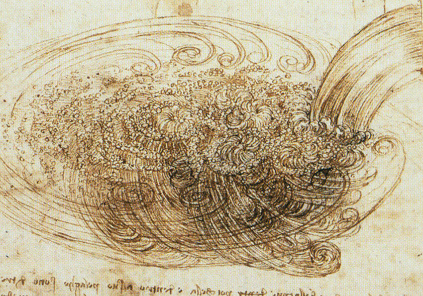
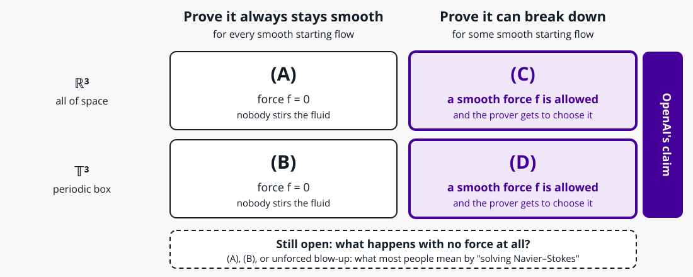
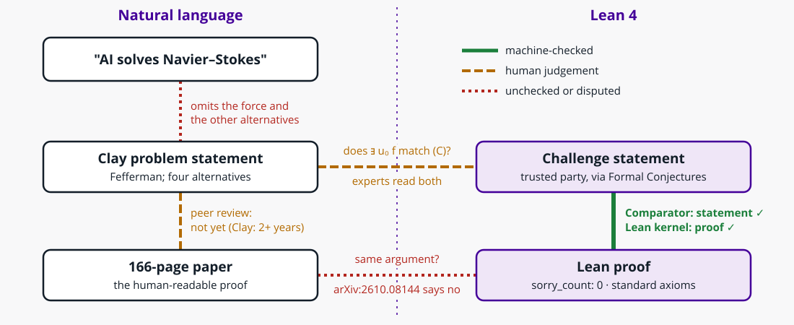
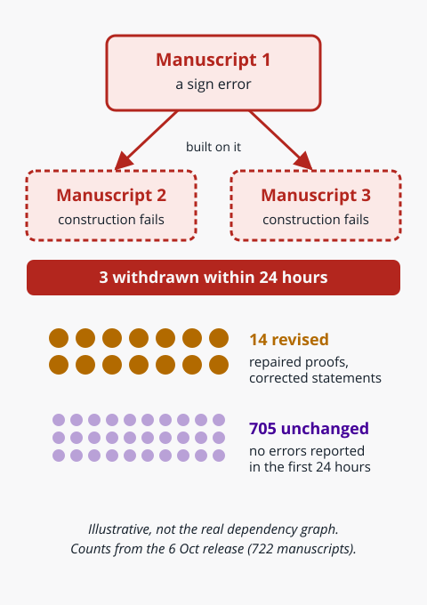
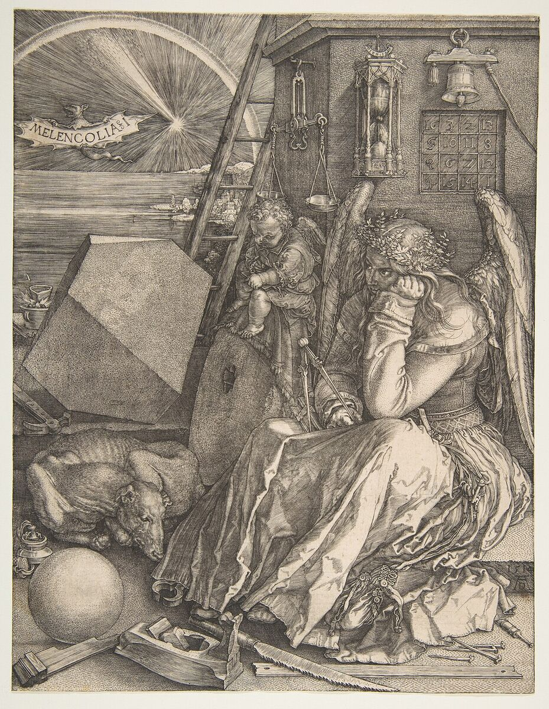

<!-- _class: lead -->
<!-- _footer: "Albrecht Dürer, _The Four Horsemen_ (1498). National Gallery of Art, CC0" -->




# Mathpocalypse

_AI agents and the dawn of machine-generated mathematics_

**Session:** 27th October 2026
**Lead:** Joe Heffer

---

## Overview

- What is the "Mathpocalypse"?
- How we got here (2024–2026)
- How it was done: swarms, Lean & Comparator
- What was *actually* proven
- The human fallout
- Practical activity: *Read the certificate*

---

<!-- _class: lead -->
<!-- _footer: "Katsushika Hokusai, _The Great Wave off Kanagawa_ (c. 1830–32), cropped. Metropolitan Museum of Art, public domain" -->



# Introduction

_Five weeks that changed mathematics_

<!-- The wave: 722 manuscripts landing at once. Hokusai's boatmen are still rowing. -->

---

## Two headline events

**8 Sep 2026 — Navier–Stokes** (OpenAI)
- ~10,000 agents, 88 hours, an unreleased internal model
- 166-page proof of **finite-time blow-up with smooth forcing** for 3D Navier–Stokes
- Formalised in Lean 4; one of the Clay Millennium Prize alternatives

**6 Oct 2026 — the bulk release** (`openai/math`)
- ~4,000 open problems posed → **722 manuscripts in 372 result families**
- ~42% of top-line results formalised in Lean
- 3 withdrawn the next day, 14 revised

---

## Why "Mathpocalypse"?

- **Volume:** more claimed results in a month than many subfields produce in a decade
- **Speed:** a Millennium-adjacent problem in under four days of wall-clock time
- **Opacity:** only 10 reasoning summaries released; experts call the 166-page proof hard to read
- **Disruption:** priority disputes, a Fields Medallists' declaration, a new IAS advisory group

> "Reaching these lighthouses prematurely by automated tools can … sterilize the surrounding field." — Terence Tao, "Math 2.0" (9 Oct 2026)

<!-- Sarcastic name, serious question: is this a flourishing of a new kind of research, or something that hollows out the old kind? The quote is verbatim from Tao's Math 2.0 slides; "lighthouses" = open problems as guides to the landscape around them. It replaces an unsourced "strip-mining of open problems" quote: secondary coverage reports a Tao thread making the same point, but we couldn't find that wording (checked 18 Oct).

Discussion: a new kind of research? Genuinely new, or the industrialisation of an old loop (search + check)? What stays human: choosing questions, explanation, "the art side"? -->

---

<!-- _class: lead -->
<!-- _footer: "Paul Erdős and Terence Tao, University of Adelaide, 1985 (cropped). Photo: Billy or Grace Tao, CC BY-SA 2.0" -->



# How we got here

_From competition problems to open problems_

<!-- Erdős working through problems with a 10-year-old Tao. Both names recur: Erdős problems are the testbed for AI novelty claims, and Tao is quoted throughout. -->

---

## Timeline (1/2): competition maths

| When | What | Why it matters |
|------|------|----------------|
| 2024 | **AlphaProof / AlphaGeometry**: IMO silver | RL + Lean on competition problems |
| 2025 | **IMO golds** (OpenAI, DeepMind; Harmonic's **Aristotle** in Lean) | Natural-language & formal reasoning reach the top |
| 2025 | **AlphaEvolve**; DeepMind **unstable singularities** in fluids | Search over code; computer-assisted PDE work |

---

## Timeline (2/2): open problems

| When | What | Why it matters |
|------|------|----------------|
| 2025 | **"Erdősgate"**: GPT-5 "solved" Erdős problems by *retrieving* them | Novelty is hard to check |
| Feb 2026 | **Aletheia** (DeepMind): 700 Erdős problems, 4 solved autonomously | Autonomy & novelty ratings |
| Aug 2026 | **Buckmaster & Alpöge**: AI-assisted, Lean-verified forced Euler blow-up | Humans + several labs' models |
| Sep–Oct 2026 | **OpenAI**: Navier–Stokes, then 722 manuscripts | Scale |

<!-- Callback: "Erdősgate" came up in the 01/09 session. -->

---

<!-- _class: small -->

## Meanwhile on GitHub: open, crowdsourced maths with AI

| Repo | Since | Humans + AI, in the open |
|------|-------|--------------------------|
| [Equational Theories](https://github.com/teorth/equational_theories) | 2024 | All **22M implications** between 4,694 magma laws, every one Lean-checked |
| [Erdős problems](https://github.com/teorth/erdosproblems) | 2025 | Wiki logs **~700 AI contributions**, including failed ones |
| [Formal Conjectures](https://github.com/google-deepmind/formal-conjectures) | 2025 | Lean *statements* of open problems; 280+ contributors |
| [Optimization constants](https://github.com/teorth/optimizationproblems) | 2026 | Best known bounds on 100+ constants, updated by PR |

- **Built like open-source software:** issues & PRs, Lean in CI as the referee, public history, credit per contribution
- **Contrast:** `openai/math` is *public* but not *open*. It is a one-way release that nobody else can take part in

<!-- Figures from the GitHub API and repo wikis, 18 Oct 2026; treat counts as approximate. ETP (Sep 2024 – Apr 2025, ~69 contributors, arXiv:2512.07087): most of the automation was classical automated provers, not LLMs. Erdős wiki: sorted into AI-only, AI + literature, AI + humans, and secondary roles (literature search, formalisation); it stopped updating on 30 Jun 2026. Formal Conjectures is where OpenAI's Navier–Stokes challenge statement came from (see the Comparator slide). Optimization constants (Tao blog, 22 Jan 2026): weakly verified bounds are marked *; Tao says he keeps pages up to date with Claude Code skills. -->

---

<!-- _class: small -->

## The mathematical lineage

- **Córdoba & Martínez-Zoroa** (analytic, not computer-assisted): build a singularity from an infinite stack of smooth layers
- The hard part: keep the **external forcing smooth** as the layers pile up
- Tao's summary of the method: start from a smooth low-frequency solution, add small high-frequency corrections that exploit an **instability** of the linearised equation, so that each stage grows just enough to break smoothness at the blow-up time
- Buckmaster & Alpöge pushed this to forced Euler/IPM/Boussinesq with heavy AI assistance (Claude, Codex)
- OpenAI's swarm reportedly ended up on a **different route** to Navier–Stokes (SciAm, citing Cao-Labora)

<!-- "Ten years ago, nobody believed there was a singularity for Navier–Stokes." — Diego Córdoba -->

---

<!-- _class: lead -->

# How it was done

_Two pipelines, one model_

---

<!-- _class: small -->

## Two pipelines

| | **Bulk release** (`openai/math`) | **Navier–Stokes swarm** |
|---|---|---|
| Shape | One fixed procedure, ×~4,000 problems | ~10,000 cooperating agents |
| Compute | ~3 h of "ChatGPT Pro thinking" per result on average | 88 h wall-clock; "millions" of dollars |
| Output | Filtered for significance → families → manuscripts | 166-page paper + Euler paper |
| Checking | ~42% Lean-formalised | Fully formalised; Comparator challenge |
| Warm-up | Saturated internal maths evals | ~100 agents × ~50 h on Euler |

<!-- The bulk release is "best-of-N with a filter"; the swarm is a genuine multi-agent system. Different engineering problems. -->

---

<!-- _class: small -->

## Anatomy of the swarm (as reported)



- Tools: cached internet, code execution, Lean 4 checker. ~2.7–5 million messages; ~130 billion output tokens (figures vary by source)
- **Key design idea:** only *verified* results enter the shared library, so the checker acts as a quality gate

---

<!-- _class: small -->

## Why the swarm works: a cheap, trustworthy verifier

- Agents write arguments in **Lean 4 + Mathlib**; the Lean kernel accepts or rejects each step
- That turns open-ended research into **search with a reliable reward signal**:
  - generation is cheap and noisy
  - verification is cheap and (nearly) exact
  - so scale up generation and let the checker filter
- After the 88-hour run, **another model autoformalised** the final proof in ~17 hours
- Same idea as AlphaProof and Aristotle, at roughly 10,000× the parallelism
- **Why maths fell first** (Tao): proofs are *objectively verifiable*, *fully digital* (no lab, no real-world data) and backed by a *large, high-quality literature*

<!-- Contrast with the 01/09 session: in most fields there is no Lean kernel, so verification is the expensive human step. Tao's three properties double as a checklist for the question below.

Discussion: beyond maths. Maths has Lean, a cheap trustworthy verifier. What is the equivalent in physics, engineering, software? Where is there none? (→ research certificates, 10/11) -->

---

## What does "Lean-verified" certify?

From `formalization.yaml` in `openai/NavierStokesAndEuler`:

```yaml
status:
  scope: "Full formalization of main results."
  sorry_count: 0          # no unproven gaps left in the proof
  main_results:
    - declaration: "NavierStokes.Comparator.navier_stokes_breakdown_R3"
      axioms: ["propext", "Classical.choice"]   # standard foundations only
```

- ✅ The proof of **this statement** is complete and uses only standard axioms
- ❓ Is **this statement** the problem you care about?

---

<!-- _class: small -->

## Comparator: whose statement is it?

- [`leanprover/comparator`](https://github.com/leanprover/comparator) — a "trustworthy judge" for Lean proofs (now `lake comparator` in core Lean)
- The **challenge** (theorem + `sorry`) comes from a trusted party; the **solution** from an untrusted one
- Comparator runs a sandbox, checks the statements match **exactly**, checks only permitted axioms are used, and can re-check with a second kernel (nanoda)
- OpenAI's challenge statement was adapted from Google DeepMind's **Formal Conjectures** — written *before*, by *someone else*

```lean
theorem navier_stokes_breakdown_R3 (nu : ℝ) (hnu : nu > 0) :
    ∃ (u₀ : ℝ³ → ℝ³) (f : ℝ³ → ℝ → ℝ³),
    InitialVelocityConditionDecay u₀ ∧ ForceConditionDecay f ∧
    ¬ (∃ v p, NavierStokesExistenceAndSmoothnessRn nu u₀ f v p) := by
  sorry
```

---

<!-- _class: lead -->
<!-- _footer: "Leonardo da Vinci, _Studies of water passing obstacles and falling_ (c. 1508), detail. Public domain" -->



# What was actually proven?

_Reading the small print_

<!-- Leonardo was drawing turbulence 300 years before Navier and Stokes wrote down the equations. -->

---

## Clay's four ways to win



<!-- From Fefferman's official problem statement for the Clay Institute. (A) and (B) ask for global smooth solutions with zero force; (C) and (D) ask for a counterexample and let the prover pick a smooth, decaying force. That asymmetry is the loophole on the next slide. Source: Fefferman (2000), Clay problem statement. -->

---

<!-- _class: small -->

## Scope: the forcing loophole

- Clay's problem statement (Fefferman) offers **four** alternatives. OpenAI claims **(C)** on ℝ³ and **(D)** on the torus: *breakdown* given smooth initial data **and a smooth external force**
- `∃ u₀ f` — **the prover chooses the force**. It is a "weird, unphysical force" constructed to stir the fluid into blowing up
- The cleaner question — blow-up with **no** forcing — remains open (Tao thinks the methods could get there)
- OpenAI separately proves **unforced Euler** blow-up (no viscosity)
- Clay: "has apparently been settled", but the status stays **active**; verification is "deliberately unhurried"; the prize needs publication + 2 years of scrutiny. OpenAI says it won't claim the prize

---

<!-- _class: small -->

## The translation gap

**Bastounis, Circelli & Hansen (arXiv:2610.08144), "Navier–Stokes lost in translation"**

- A Lean check certifies the **formal** statement and proof, not the **English** paper
- They report that OpenAI's Lean proof **does not correspond** to its natural-language proof
- They argue that faithful autoformalisation of ambiguous natural-language maths is, in general, harder than the Halting problem
- Practical upshot: two artefacts (166-page PDF + Lean project) that may say *different things*, both hard to read

> "It's not anymore a matter of clearly verifiable mathematical facts." — Camillo De Lellis (IAS)

---

## Where the trust gaps are



Lean closes **one** link, from formal statement to formal proof. The others still need people.

<!-- Recap of the last three slides in one picture. Green is cheap and near-certain; amber is expert time; red is where the arguments are. Good warm-up for the practical: Track A is the amber link, Track C is the green one. -->

---

<!-- _class: small -->

## The cascading withdrawal



From the bulk release, within 24 hours:

- A **sign error** broke one manuscript's argument
- **Two other** manuscripts relied on constructions that depended on it → all **3 withdrawn**
- **14 more revised** with proof repairs and corrected statements
- Some results "touch on" the Riemann hypothesis, Hodge or Kakeya — far weaker than "solved"

**Lesson for RSEs:** an unformalised AI result is a *dependency* with no tests. Errors propagate through the dependency graph, just as they do in software.

<!-- Discussion: who pays for verification? 719 unreviewed manuscripts land at once: a gift, or a denial-of-service on peer review? No journal submission announced by any lab (as of 18 Oct). Should there be? (cf. 01/09: finding is cheap, adjudicating is expensive) -->

---

<!-- _class: lead -->
<!-- _footer: "Albrecht Dürer, _Melencolia I_ (1514). Metropolitan Museum of Art, CC0" -->



# The human fallout

_Credit, priority, and the ecosystem_

<!-- Dürer's brooding scholar: surrounded by geometry tools, a polyhedron and a magic square, and not getting any work done. Existential dread about maths is at least 500 years old. -->

---

<!-- _class: small -->

## Priority and credit (facts, not verdicts)

- **15–22 Aug:** Buckmaster (NYU) & Alpöge (Anthropic, collaborating personally) get AI-assisted, Lean-verified forced Euler/IPM/Boussinesq results
- **1 Sep:** OpenAI starts its 88-hour Navier–Stokes run
- **6 Sep:** OpenAI meets Buckmaster; accounts of the proposed arrangement are **disputed**
- **7–8 Sep:** Buckmaster's statement, then OpenAI's announcement ~12 h later
- OpenAI says user Codex sessions **could not** have influenced the system; it "recognises the priority" of their work
- Open question: what does "credit" mean when the closest humans used the same lab's tools?

<!-- Keep this neutral; the facts are contested and sources differ. Point to Fortune / NYT / Buckmaster's statement for the detail.

Discussion: how should credit work when the "closest humans" are outpaced by a swarm, possibly running on tools they also used? -->

---

<!-- _class: small -->

## How mathematicians responded

- **Fields Medallists' declaration** "A Severe Misalignment of AI in Mathematics": solving problems is only a proxy for understanding
- **Tao:** problems being solved by prompters "who have no interest in the broader field"; dead ends that labs don't disclose often hold the insight
- **Melanie Wood (Harvard):** there is no human understanding at release, so "the work begins" then
- **Strogatz (Cornell):** "What's surprising is how fast they have gotten good"
- **Association for Human Mathematics:** "not a demonstration of scholarship, but a demonstration of power"
- **Dan Litt (Toronto):** "great for mathematics", but human expertise still needs support

---

<!-- _class: small -->

## Rumour: results held in reserve?

- **Reported:** during the Navier–Stokes dispute, comments from OpenAI staff led some mathematicians to believe the model "had produced additional results but that it was hesitating to publicize them" (_Scientific American_, 6 Oct)
- **Then:** the 6 Oct release of 372 results, preceded by weeks of rumours that it was coming
- **Rumoured motive (unsourced):** holding back to avoid upsetting, or swamping, professional mathematicians
- **No public evidence** of a reserve or of that motive. OpenAI says it _can't_ slow down, because the problems are a test of capability
- **Why it's plausible anyway:** no count of problems attempted or failed, no prompts, average compute only, and the model is unreleased

**Ask:** if a reserve exists, is holding it back responsible stewardship, or gatekeeping?

<!-- This slide is hearsay by design: present it as a rumour and don't let it harden into fact. The withholding belief is in SciAm (Howlett, 6 Oct 2026); the "sparing mathematicians" motive has no source we could find (searched 18 Oct). Leads into IAS rec #6 on the next slide. -->

---

<!-- _class: small -->

## IAS Advisory Group: responsible release

Independent, unpaid, hosted at IAS Princeton; recommendations published 29 Sep 2026

1. **Stop** testing advanced open problems on proprietary, inaccessible models
2. Deposit results in repositories **no AI lab controls**, with persistent IDs
3. Don't use results as **model marketing**
4. Per result, disclose: **model, prompts, summarised chain of thought, time, compute**
5. **Formalise** as far as possible
6. For bulk releases: say how many problems were **attempted and failed**, and how they were chosen
7. Fund **human understanding** (schools, workshops, expository writing) and give equitable **model access**

<!-- Reportedly the 6 Oct release fell short of several of these, including #1. Good input for Track B. On #6, Tao's Math 2.0 talk makes the same point about reporting bias: press releases show the successes, not the unreported failed attempts, so most frontier problems are still unsolved. He points to First Proof (1stproof.org) as an attempt at honest assessment.

Discussion: a two-tier science? Unreleased proprietary model; the Navier–Stokes run alone cost millions of dollars. Is #1 ("stop testing on proprietary models") realistic? What does it mean for universities?

Discussion: your rule. What one rule would you add for releasing AI-generated results in *your* field? -->

---

<!-- _class: small -->

## A better future: "Math 2.0"

Tao's Caltech lecture (9 Oct 2026): proofs used to be **scarce**, now they are **abundant**. Solving problems was only ever a *proxy* for progress, so optimising it blindly is "now actively harmful"

|                          | Light AI use | Heavy AI use        |
| ------------------------ | ------------ | ------------------- |
| **Weak understanding**   | Pre-math     | Misaligned math     |
| **Strong understanding** | Math 1.0     | **Math 2.0**        |

- The danger is **heavy AI + weak human understanding**, not AI itself
- **Use AI to deepen understanding:** "open exposition problems" (explain opaque proofs), ablation studies on known theorems, living networks of results, formal libraries, open maths models

> "The primary bottleneck to achieving 'Math 2.0' is not technology, or even institutional culture. It is imagination."

<!-- The optimistic payoff after the fallout section, from the same person quoted as a critic earlier. IAS rec #7 (fund human understanding) leads straight into this. Examples: Equational Theories Project (22M statements), SAIR/LMFDB Inverse Galois challenge, Caltech Mathathon, IEANTN. Full notes in docs/tao-math-2-0.md.

Discussion: is understanding the product? Tao's thought experiment: an AI designs a cancer cocktail nobody understands. It has a Lean certificate and passes a phase 3 trial. Would you take it? Medicine says yes: penicillin and aspirin were used for decades before anyone knew how they worked. In *your* field, is understanding the output or a means to it? -->

---

<!-- _class: small -->

## Summary: the "six fingers" stage

A few years ago, AI images were easy to spot: **six fingers**, melted text, impossible hands. Today those flaws feel like ancient history

AI maths research is at the same point now:

- Forcing loopholes, translation gaps, withdrawn manuscripts, unread 166-page proofs
- These are real problems, but they are **early-stage** problems
- If capabilities keep improving as they have since 2022 (roughly exponentially, or faster), today's mistakes will look as quaint as six-fingered hands, in maths *and* in physics, biology and beyond

**The question isn't *whether* the fingers get fixed. It's what we do once they are**

<!-- The closing joke, and the session's optimistic stance in one image. Everything in "What was actually proven?" is a six-fingers problem: obvious once you look, embarrassing, and probably temporary. That doesn't make the critiques wrong today. It means they're the critiques of 2026, not of the field. Tao's "Math 2.0" is one answer to "what do we do once the fingers are fixed?"

Discussion: what is the "six fingers" of AI research in *your* field: the tell-tale flaw that gives it away today? Will it still be there in three years? Is there anything that *won't* get fixed by scale (e.g. verification without a Lean, choosing good questions)? -->

---

<!-- _class: lead -->

# Practical activity

_Read the certificate_

---

<!-- _class: small -->

## Read the certificate (25 min, in pairs)

Pick **one** track (15 min), then report back (10 min).

- **A: Statement vs headline** (no install). Open `ComparatorChallenges/NavierStokes.lean` in `openai/NavierStokesAndEuler`. Write `navier_stokes_breakdown_R3` out in English. Where is the force? Who picks it? Compare with "AI solves Navier–Stokes"
- **B: Audit a family** (no install). Pick a family in `openai/math`. Score it on the IAS checklist. How long would an expert need to trust it? ×719?
- **C: Build it** (needs elan). `lake exe cache get && lake build`, then `#print axioms` on the main theorem. What does `sorry_count: 0` certify, and what doesn't it?

**Report back:** *in one sentence, what has actually been verified, and by whom?*

---

<!-- _class: small -->

## Links & resources

- OpenAI: [On the Navier–Stokes Millennium Prize Problem](https://openai.com/index/navier-stokes-solution/) · [Sharing AI progress in mathematics](https://openai.com/index/sharing-ai-progress-in-mathematics/)
- Code: [openai/NavierStokesAndEuler](https://github.com/openai/NavierStokesAndEuler) · [openai/math](https://github.com/openai/math) · [leanprover/comparator](https://github.com/leanprover/comparator) · [Formal Conjectures](https://github.com/google-deepmind/formal-conjectures)
- [Quanta explainer](https://www.quantamagazine.org/ai-has-solved-one-of-maths-1-million-millennium-prize-problems-20260908/) · [Tao's blog](https://terrytao.wordpress.com/2026/09/07/finite-time-blowup-with-smooth-forcing-term-for-the-incompressible-porous-medium-boussinesq-and-incompressible-euler-equations) · [Clay statement](https://www.claymath.org/news/navier-stokes-announcement)
- Tao, "Math 2.0": [video](https://aimath.org/videos/terry-tao-pl/) · [slides](https://teorth.github.io/tao-web/slides/math-2-0-caltech-2026.pdf) · [blog & comments](https://terrytao.wordpress.com/2026/10/10/math-2-0/)
- [Navier–Stokes lost in translation (arXiv:2610.08144)](https://arxiv.org/abs/2610.08144) · [Aletheia (arXiv:2602.10177)](https://arxiv.org/abs/2602.10177)
- In this repo: [Harmonic Aristotle idea](../../ideas/mathematics-harmonic-aristotle.md) · [Agents Reviewing Old Papers](../2026-09-01-agents-reviewing-old-papers/README.md) · [Research certificates](../2026-11-10-research-certificates.md)
- Full citations in `references.bib`

---

<!-- _class: small -->

## Image credits

- Albrecht Dürer, *The Four Horsemen* (1498), woodcut. National Gallery of Art, Washington. [CC0](https://creativecommons.org/publicdomain/zero/1.0/), via [Wikimedia Commons](https://commons.wikimedia.org/wiki/File:Albrecht_D%C3%BCrer,_The_Four_Horsemen,_1498,_NGA_142352.jpg)
- Katsushika Hokusai, *The Great Wave off Kanagawa* (c. 1830–32), cropped. Metropolitan Museum of Art. Public domain, via [Wikimedia Commons](https://commons.wikimedia.org/wiki/File:Tsunami_by_hokusai_19th_century.jpg)
- *Paul Erdős with Terence Tao*, University of Adelaide (1985), cropped. Photo by Billy or Grace Tao. [CC BY-SA 2.0](https://creativecommons.org/licenses/by-sa/2.0/), via [Wikimedia Commons](https://commons.wikimedia.org/wiki/File:Paul_Erdos_with_Terence_Tao.jpg)
- Leonardo da Vinci, *Studies of water passing obstacles and falling* (c. 1508), detail. Public domain, via [Wikimedia Commons](https://commons.wikimedia.org/wiki/File:Studies_of_water,_by_Leonardo_da_Vinci_(detail).jpg)
- Albrecht Dürer, *Melencolia I* (1514), engraving. Metropolitan Museum of Art. [CC0](https://creativecommons.org/publicdomain/zero/1.0/), via [Wikimedia Commons](https://commons.wikimedia.org/wiki/File:Melencolia_I_MET_DP815743.jpg)
- Diagrams in `diagrams/` were drawn for this session. The swarm diagram follows OpenAI's reported description; the cascade is illustrative
