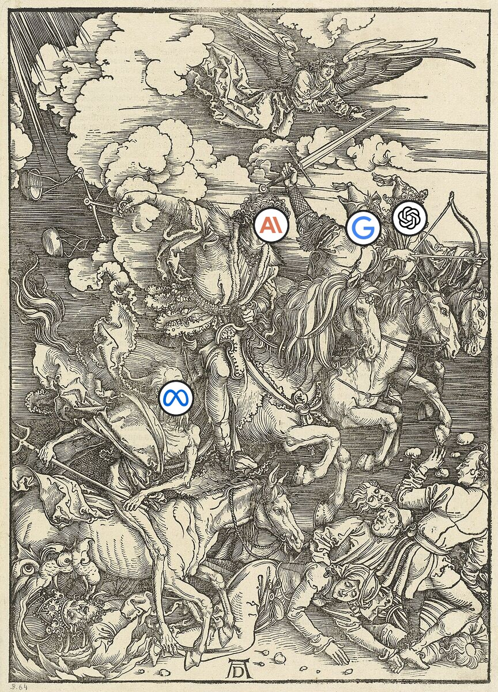
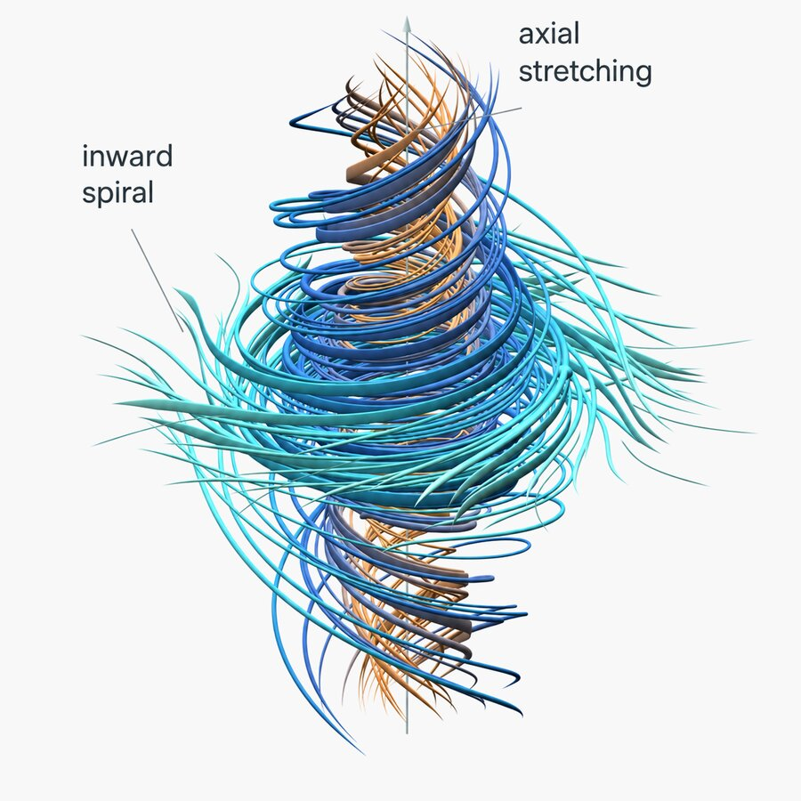

<!-- _class: lead -->
<!-- _footer: "Albrecht Dürer, _The Four Horsemen_ (1498). National Gallery of Art, CC0, with AI company logos added (trademarks of their owners)" -->




# Mathpocalypse

_AI agents and the dawn of machine-generated mathematics_

**Session:** 27th October 2026
**Lead:** Joe Heffer

---

## Overview

- What is the "Mathpocalypse"?
- How we got here (2024–2026)
- How it was done: agent swarms and proof-checking software
- What was *actually* proven
- The human fallout
- The future of AI-augmented maths research
- Practical activity: *Read the certificate*

---

<!-- _class: lead -->
<!-- _footer: "Katsushika Hokusai, _The Great Wave off Kanagawa_ (c. 1830–32), cropped. Metropolitan Museum of Art, public domain" -->


# Introduction

_Five weeks that changed mathematics_

<!-- The wave: 722 manuscripts landing at once. Hokusai's boatmen are still rowing. -->

---

<!-- _class: small -->
<!-- _footer: "Blow-up vortex visualisation from OpenAI, \"On the Navier–Stokes Millennium Prize Problem\" (8 Sep 2026). © OpenAI" -->



## Two headline events

**8 Sep 2026 — Navier–Stokes** (OpenAI)
- ~10,000 agents, 88 hours, an unreleased internal model
- 166-page proof that a smoothly flowing fluid **can suddenly break down**, if you may push it with a carefully chosen force
- Computer-checked in Lean; claims one of the four ways to "win" this $1M Millennium Prize problem

**6 Oct 2026 — the bulk release** (`openai/math`)
- ~4,000 open problems posed → **722 manuscripts in 372 result families** (groups of related results)
- ~42% of top-line results formalised in Lean
- 3 withdrawn the next day, 14 revised

---

## Why "Mathpocalypse"?

- **Pace:** output now outruns humans: hundreds of claimed results in one release, a Millennium-adjacent problem in under four days
- **Significance:** not olympiad or textbook exercises any more: open research problems at the frontier
- **Opacity:** only 10 reasoning summaries released; experts call the 166-page proof hard to read
- **Disruption:** priority disputes, a declaration by Fields Medallists (winners of maths' top prize), a new advisory group at the Institute for Advanced Study (IAS), and a crisis of meaning for professional mathematicians

> "Reaching these lighthouses prematurely by automated tools can … sterilize the surrounding field." — Terence Tao, "Math 2.0" (9 Oct 2026)

<!-- Sarcastic name, serious question: is this a flourishing of a new kind of research, or something that hollows out the old kind? The quote is verbatim from Tao's Math 2.0 slides; "lighthouses" = open problems as guides to the landscape around them. It replaces an unsourced "strip-mining of open problems" quote: secondary coverage reports a Tao thread making the same point, but we couldn't find that wording (checked 18 Oct).

Significance: the step change is in level, not only in volume. In 2024–25 the headline results were IMO medals, which are hard problems with known answers. In 2026 they are open problems with no known answer: Erdős problems and a Navier–Stokes variant (see the timeline in "How we got here").

Discussion: a new kind of research? Genuinely new, or the industrialisation of an old loop (search + check)? What stays human: choosing questions, explanation, "the art side"? -->

---

<!-- _class: small -->

## Jargon buster

- **Open problem:** a question nobody knows the answer to (unlike an exam or olympiad problem)
- **Proof:** an argument that something is *always* true, where every step can be checked
- **Lean:** a programming language where a proof is code: if it compiles, the proof is correct. *Mathlib* is its shared standard library
- **Formalise:** translate a paper proof into Lean, a bit like porting pseudocode to a strictly typed language
- **`sorry`:** Lean's `TODO`, a gap left unproven
- **Navier–Stokes:** the equations for how water and air flow. The open question: can a smooth flow suddenly "break" (*blow up*)?
- **Millennium Prize:** seven $1M problems set by the Clay Institute in 2000. Navier–Stokes is one of them
- **Erdős problems:** ~1,000 open puzzles collected from the mathematician Paul Erdős, now a popular test for AI

<!-- A reference slide to come back to. Everything later builds on these eight terms. The RSE analogies (compiler, TODO, typed language) are deliberate: Lean really is a programming language, and Lean projects are built with `lake` like any other codebase. -->

---

<!-- _class: lead -->
<!-- _footer: "Paul Erdős and Terence Tao, University of Adelaide, 1985 (cropped). Photo: Billy or Grace Tao, CC BY-SA 2.0" -->


# How we got here

_From competition problems to open problems_

<!-- Erdős working through problems with a 10-year-old Tao. Both names recur: Erdős problems are the testbed for AI novelty claims, and Tao is quoted throughout. -->

---

<!-- _class: small -->

## Timeline (1/2): competition maths

| When | What | Why it matters |
|------|------|----------------|
| 2024 | **AlphaProof**: silver at the International Maths Olympiad (IMO, for school students) | Trial-and-error learning + Lean-checked proofs |
| 2025 | **IMO golds**: OpenAI, DeepMind, Harmonic | Top human level |
| 2025 | **AlphaEvolve** (with Tao) | New records on ~20 problems |
| 2025 | **Putnam** (top undergrad contest): 12/12 | Perfect score (self-reported) |

<!-- Detail: Putnam = the William Lowell Putnam Mathematical Competition, the hardest undergraduate maths contest in the US/Canada; 12 proof problems in two 3-hour sessions, and the median human score is often 0–2 out of 120. AlphaGeometry (LM proposes constructions, symbolic engine proves) shared the 2024 IMO result. 2025 IMO golds also included DeepSeek; Harmonic's Aristotle was in Lean. AlphaEvolve with Tao and Gómez-Serrano: 67 problems, ~20 improved bounds (i.e. constructions beating the previous best known value; the exact answers are still unknown). Putnam 12/12 claims from AxiomProver and Numina-Lean. Also 2025: DeepMind "unstable singularities" in fluids (computer-assisted PDE work), a precursor to the Navier–Stokes results on the next slide. -->

---

<!-- _class: small -->

## Timeline (2/2): open problems

| When | What | Why it matters |
|------|------|----------------|
| 2025 | **"Erdősgate"**: GPT-5 "solved" Erdős problems that were already solved in the literature | Novelty is hard to check |
| Feb 2026 | **Aletheia** (DeepMind): 700 Erdős problems, 4 solved autonomously | Rated each result for independence & novelty |
| Aug 2026 | **Buckmaster & Alpöge**: AI-assisted, Lean-checked blow-up for a simpler fluid equation | Humans + several labs' models |
| Sep–Oct 2026 | **OpenAI**: Navier–Stokes, then 722 manuscripts | Scale |

<!-- Callback: "Erdősgate" came up in the 01/09 session. -->

---

<!-- _class: small -->

## Secret models only? Who can use what

| Result | Model | Public? |
|--------|-------|---------|
| Navier–Stokes + `openai/math` (Sep–Oct) | OpenAI internal | **No** |
| Riemann hypothesis: partial progress, 41.6% → 67.2% (Aug) | Unreleased Claude | **No** |
| FrontierMath benchmark: a 2019 open problem (Mar) | GPT-5.4 Pro and others | **Yes** |
| Gowers: number-theory estimates (May) | ChatGPT 5.5 Pro | **Yes** |
| Busy Beaver (how long tiny programs run), by an amateur (Oct) | Claude Code | **Yes** |

- **Headlines** use unreleased models and heavy compute; **smaller results** use ordinary subscriptions. Aaronson expects the gap to close "within the next couple of months"

**Ask:** if the gap is only months, what does a lab gain by keeping its model in-house?

<!-- Answers the question we keep getting: "were these all secret models?" Table rows in full: OpenAI's model is unnamed. Anthropic called the zeta model an "unreleased research version of Claude". FrontierMath also fell to Gemini 3.1 Pro and Opus 4.6. Gowers improved bounds on Nathanson's problems. Busy Beaver asks how long tiny programs can run before stopping. Riemann row, precisely: the proven proportion of non-trivial zeros of the Riemann zeta function that lie on the critical line rose from 41.6% to 67.2%. The hypothesis says it's 100%. Model names are hedged on purpose. Claude Mythos Preview is real but invitation-only, and reports link it to Anthropic's July cryptography results, *not* the zeta result; Anthropic hasn't named the zeta model. GPT-6 Astra is a public model (in Codex, 49/50 on TheoPhysEval). Lab-reported figures put OpenAI's internal model at ~45% on a curated set of open problems and Astra below 20% (Aaronson, comment #151). "Bel" turned up nothing when we searched (19 Oct); treat it as a rumour.

Gowers: "I didn't even do anything clever with the prompts" (The Decoder, 9 May). Knuth's directed-graph problem is another public-model case, but accounts disagree on credit (Claude Opus 4.6 versus GPT-5.3-codex and GPT-5.4 Pro), so it's left off the table. Busy Beaver: Aaronson's 12 Oct update. Leads into IAS rec #1 ("stop testing on proprietary models") and the two-tier science question. -->

---

<!-- _class: small -->

## Meanwhile on GitHub: open, crowdsourced maths with AI

| Repo | Since | Humans + AI, in the open |
|------|-------|--------------------------|
| [Equational Theories](https://github.com/teorth/equational_theories) | 2024 | All **22M** "does rule X imply rule Y?" questions for 4,694 simple algebra rules, every one Lean-checked |
| [Erdős problems](https://github.com/teorth/erdosproblems) | 2025 | Wiki logs **~700 AI contributions**, including failed ones |
| [Formal Conjectures](https://github.com/google-deepmind/formal-conjectures) | 2025 | Lean *statements* of open problems; 280+ contributors |
| [Optimization constants](https://github.com/teorth/optimizationproblems) | 2026 | Best known estimates for 100+ numbers nobody knows exactly, updated by PR |

- **Built like open-source software:** issues & PRs, Lean in CI as the referee, public history, credit per contribution
- **Contrast:** `openai/math` is *public* but not *open*. It is a one-way release that nobody else can take part in

<!-- Figures from the GitHub API and repo wikis, 18 Oct 2026; treat counts as approximate. ETP precisely: all 22M implications between 4,694 equational laws of magmas (a set with one binary operation). ETP (Sep 2024 – Apr 2025, ~69 contributors, arXiv:2512.07087): most of the automation was classical automated provers, not LLMs. Erdős wiki: sorted into AI-only, AI + literature, AI + humans, and secondary roles (literature search, formalisation); it stopped updating on 30 Jun 2026. Formal Conjectures is where OpenAI's Navier–Stokes challenge statement came from (see the Comparator slide). Optimization constants (Tao blog, 22 Jan 2026): weakly verified bounds are marked *; Tao says he keeps pages up to date with Claude Code skills. -->

---

<!-- _class: small -->

## The road to Navier–Stokes: the mathematical lineage

**Main point:** the AI Navier–Stokes result builds on years of human work. The AI did not start from scratch.

- **Navier–Stokes:** the equations for how fluids like water and air move. The big open question: can a flow that starts out smooth suddenly "break", i.e. develop a point where it stops being smooth (a *blow-up*)?
- **Human groundwork:** Córdoba & Martínez-Zoroa found a recipe with pen and paper. Stack up ever-smaller swirls, each one growing just enough, until the flow breaks at a chosen moment
- **The catch:** the recipe needs an outside push on the fluid (a *forcing*). That push must stay smooth itself, or you have just put the break in by hand
- **AI-assisted step:** Buckmaster & Alpöge applied the recipe to related fluid equations with help from Claude and Codex, and checked the proof in Lean
- **OpenAI's swarm** reportedly reached Navier–Stokes by a **different route** (SciAm, citing Cao-Labora)

**Discuss:** who gets credit when an AI extends a human research programme?

<!-- "Ten years ago, nobody believed there was a singularity for Navier–Stokes." — Diego Córdoba. Tao's technical summary of the method: start from a smooth low-frequency solution, add small high-frequency corrections that exploit an instability of the linearised equation, so each stage grows just enough to break smoothness at the blow-up time. "Smaller swirls" = higher-frequency corrections. Córdoba & Martínez-Zoroa is analytic, not computer-assisted. Buckmaster & Alpöge covered forced Euler, IPM (porous media flow) and Boussinesq (fluid with temperature/buoyancy). -->

---

<!-- _class: lead -->

# How it was done

_Two pipelines, one model_

---

<!-- _class: small -->

## Two pipelines

| | **Bulk release** (`openai/math`) | **Navier–Stokes swarm** |
|---|---|---|
| Shape | One fixed procedure, ×~4,000 problems | ~10,000 cooperating agents |
| Compute | ~3 h of "ChatGPT Pro thinking" per result on average | 88 h start to finish; "millions" of dollars |
| Output | Filtered for significance → families → manuscripts | 166-page paper + companion paper (simpler Euler equation) |
| Checking | ~42% Lean-checked | Fully Lean-checked; statement checked independently (Comparator, see later) |
| Warm-up | First maxed out OpenAI's internal maths tests | ~100 agents × ~50 h on Euler |

<!-- The bulk release is "best-of-N with a filter"; the swarm is a genuine multi-agent system. Different engineering problems. -->

---

<!-- _class: small -->

## Anatomy of the swarm (as reported)


- Tools: cached internet, code execution, Lean 4 checker. ~2.7–5 million messages; ~130 billion output tokens (figures vary by source)
- **Key design idea:** only *verified* results enter the shared library, so the checker acts as a quality gate

---

<!-- _class: small -->

## Why the swarm works: a cheap, trustworthy verifier

- Agents write arguments in **Lean 4 + Mathlib**; Lean's checker (its *kernel*) passes or fails each step, like a compiler
- That turns open-ended research into **search with a reliable pass/fail signal**:
  - generation is cheap and noisy
  - verification is cheap and (nearly) exact
  - so scale up generation and let the checker filter
- After the 88-hour run, **another model translated** the final proof fully into Lean in ~17 hours
- Same idea as AlphaProof and Aristotle, at roughly 10,000× the parallelism
- **Why maths fell first** (Tao): proofs are *objectively verifiable*, *fully digital* (no lab, no real-world data) and backed by a *large, high-quality literature*

<!-- Contrast with the 01/09 session: in most fields there is no Lean kernel, so verification is the expensive human step. Tao's three properties double as a checklist for the question below.

Discussion: beyond maths. Maths has Lean, a cheap trustworthy verifier. What is the equivalent in physics, engineering, software? Where is there none? (→ research certificates, 10/11) -->

---

## What does "Lean-verified" certify?

From `formalization.yaml` in `openai/NavierStokesAndEuler`:

```yaml
status:
  scope: "Full formalization of main results."
  sorry_count: 0          # no unproven gaps left in the proof
  main_results:
    - declaration: "NavierStokes.Comparator.navier_stokes_breakdown_R3"
      axioms: ["propext", "Classical.choice"]   # standard foundations only
```

- In software terms: it compiles, with no `TODO`s and no extra assumptions
- ✅ The proof of **this statement** is complete and uses only standard axioms
- ❓ Is **this statement** the problem you care about?

---

<!-- _class: small -->

## Comparator: whose statement is it?

- [`leanprover/comparator`](https://github.com/leanprover/comparator) — a "trustworthy judge" for Lean proofs (now `lake comparator` in core Lean)
- The **challenge** (the problem statement, with the proof left as `sorry`) comes from a trusted party; the **solution** from an untrusted one
- Comparator runs a sandbox, checks the statements match **exactly**, checks only permitted axioms are used, and can re-check with a second, independent checker (nanoda)
- OpenAI's challenge statement was adapted from Google DeepMind's **Formal Conjectures** — written *before*, by *someone else*

```lean
theorem navier_stokes_breakdown_R3 (nu : ℝ) (hnu : nu > 0) :
    ∃ (u₀ : ℝ³ → ℝ³) (f : ℝ³ → ℝ → ℝ³),
    InitialVelocityConditionDecay u₀ ∧ ForceConditionDecay f ∧
    ¬ (∃ v p, NavierStokesExistenceAndSmoothnessRn nu u₀ f v p) := by
  sorry
```

Reading key: `∃` = "there exists", `¬` = "not", `u₀` = starting flow, `f` = force, `nu` = viscosity (stickiness)

---

<!-- _class: lead -->
<!-- _footer: "Leonardo da Vinci, _Studies of water passing obstacles and falling_ (c. 1508), detail. Public domain" -->


# What was actually proven?

_Reading the small print_

<!-- Leonardo was drawing turbulence 300 years before Navier and Stokes wrote down the equations. -->

---

## Clay's four ways to win


<!-- From Fefferman's official problem statement for the Clay Institute. (A) and (B) ask for global smooth solutions with zero force; (C) and (D) ask for a counterexample and let the prover pick a smooth, decaying force. That asymmetry is the loophole on the next slide. Source: Fefferman (2000), Clay problem statement. -->

---

<!-- _class: small -->

## Scope: the forcing loophole

- Clay's problem statement (Fefferman) offers **four** alternatives. OpenAI claims **(C)** in all of space and **(D)** in a repeating box: *breakdown* from a smooth starting flow **and a smooth external force**
- The Lean statement reads "there exist a starting flow `u₀` and a force `f`", so **the prover chooses the force**. It is a "weird, unphysical force" constructed to stir the fluid into blowing up
- The cleaner question — blow-up with **no** forcing — remains open (Tao thinks the methods could get there)
- OpenAI separately proves blow-up with no force for the **Euler equations** (an idealised fluid with no friction)
- Clay: "has apparently been settled", but the status stays **active**; verification is "deliberately unhurried"; the prize needs publication + 2 years of scrutiny. OpenAI says it won't claim the prize

---

<!-- _class: small -->

## The translation gap

**Bastounis, Circelli & Hansen (arXiv:2610.08144), "Navier–Stokes lost in translation"**

- A Lean check certifies the **formal** statement and proof, not the **English** paper
- They report that OpenAI's Lean proof **does not correspond** to its natural-language proof
- They argue that reliably translating ambiguous English maths into Lean automatically is, in general, harder than the Halting problem
- Practical upshot: two artefacts (166-page PDF + Lean project) that may say *different things*, both hard to read

> "It's not anymore a matter of clearly verifiable mathematical facts." — Camillo De Lellis (IAS)

---

## Where the trust gaps are


Lean closes **one** link, from formal statement to formal proof. The others still need people.

<!-- Recap of the last three slides in one picture. Green is cheap and near-certain; amber is expert time; red is where the arguments are. Good warm-up for the practical: Track A is the amber link, Track C is the green one. -->

---

<!-- _class: small -->

## The cascading withdrawal


From the bulk release, within 24 hours:

- A **sign error** broke one manuscript's argument
- **Two other** manuscripts relied on constructions that depended on it → all **3 withdrawn**
- **14 more revised** with proof repairs and corrected statements
- Some results "touch on" famous open problems (the Riemann, Hodge or Kakeya conjectures) — far weaker than "solved"

**Lesson for RSEs:** an AI result that isn't Lean-checked is a *dependency* with no tests. Errors propagate through the dependency graph, just as they do in software.

<!-- Discussion: who pays for verification? 719 unreviewed manuscripts land at once: a gift, or a denial-of-service on peer review? No journal submission announced by any lab (as of 18 Oct). Should there be? (cf. 01/09: finding is cheap, adjudicating is expensive) -->

---

<!-- _class: lead -->
<!-- _footer: "Albrecht Dürer, _Melencolia I_ (1514). Metropolitan Museum of Art, CC0" -->


# The human fallout

_Credit, priority, and the ecosystem_

<!-- Dürer's brooding scholar: surrounded by geometry tools, a polyhedron and a magic square, and not getting any work done. Existential dread about maths is at least 500 years old. -->

---

<!-- _class: small -->

## Priority and credit (facts, not verdicts)

- **15–22 Aug:** Buckmaster (NYU) & Alpöge (Anthropic, collaborating personally) get AI-assisted, Lean-checked blow-up results for three related fluid equations
- **1 Sep:** OpenAI starts its 88-hour Navier–Stokes run
- **6 Sep:** OpenAI meets Buckmaster; accounts of the proposed arrangement are **disputed**
- **7–8 Sep:** Buckmaster's statement, then OpenAI's announcement ~12 h later
- OpenAI says user Codex sessions **could not** have influenced the system; it "recognises the priority" of their work
- Open question: what does "credit" mean when the closest humans used the same lab's tools?

<!-- The three equations: forced Euler, IPM (porous media flow) and Boussinesq (fluid with buoyancy). Keep this neutral; the facts are contested and sources differ. Point to Fortune / NYT / Buckmaster's statement for the detail.

Discussion: how should credit work when the "closest humans" are outpaced by a swarm, possibly running on tools they also used? -->

---

<!-- _class: small -->

## How mathematicians responded

- **Fields Medallists' declaration** "A Severe Misalignment of AI in Mathematics": solving problems is only a proxy for understanding
- **Tao:** problems being solved by prompters "who have no interest in the broader field"; dead ends that labs don't disclose often hold the insight
- **Melanie Wood (Harvard):** there is no human understanding at release, so "the work begins" then
- **Strogatz (Cornell):** "What's surprising is how fast they have gotten good"
- **Association for Human Mathematics:** "not a demonstration of scholarship, but a demonstration of power"
- **Dan Litt (Toronto):** "great for mathematics", but human expertise still needs support

---

<!-- _class: small -->

## Rumour: results held in reserve?

- **Reported:** during the Navier–Stokes dispute, comments from OpenAI staff led some mathematicians to believe the model "had produced additional results but that it was hesitating to publicize them" (_Scientific American_, 6 Oct)
- **Then:** the 6 Oct release of 372 results, preceded by weeks of rumours that it was coming
- **Rumoured motive (unsourced):** holding back to avoid upsetting, or swamping, professional mathematicians
- **No public evidence** of a reserve or of that motive. OpenAI says it _can't_ slow down, because the problems are a test of capability
- **Why it's plausible anyway:** no count of problems attempted or failed, no prompts, average compute only, and the model is unreleased

**Ask:** if a reserve exists, is holding it back responsible stewardship, or gatekeeping?

<!-- This slide is hearsay by design: present it as a rumour and don't let it harden into fact. The withholding belief is in SciAm (Howlett, 6 Oct 2026); the "sparing mathematicians" motive has no source we could find (searched 18 Oct). Leads into IAS rec #6 on the next slide. -->

---

<!-- _class: small -->

## IAS Advisory Group: responsible release

Independent, unpaid, hosted at IAS Princeton; recommendations published 29 Sep 2026

1. **Stop** testing advanced open problems on proprietary, inaccessible models
2. Deposit results in repositories **no AI lab controls**, with persistent IDs
3. Don't use results as **model marketing**
4. Per result, disclose: **model, prompts, a summary of the model's reasoning, time, compute**
5. **Formalise** as far as possible
6. For bulk releases: say how many problems were **attempted and failed**, and how they were chosen
7. Fund **human understanding** (schools, workshops, expository writing) and give equitable **model access**

<!-- Reportedly the 6 Oct release fell short of several of these, including #1. Good input for Track B. On #6, Tao's Math 2.0 talk makes the same point about reporting bias: press releases show the successes, not the unreported failed attempts, so most frontier problems are still unsolved. He points to First Proof (1stproof.org) as an attempt at honest assessment.

Discussion: a two-tier science? Unreleased proprietary model; the Navier–Stokes run alone cost millions of dollars. Is #1 ("stop testing on proprietary models") realistic? What does it mean for universities?

Discussion: your rule. What one rule would you add for releasing AI-generated results in *your* field? -->

---

<!-- _class: lead -->

# The future of AI-augmented mathematics research

_A better future_

---

<!-- _class: small -->

## A better future: "Math 2.0"

Tao's Caltech lecture (9 Oct 2026): proofs used to be **scarce**, now they are **abundant**. Solving problems was only ever a *proxy* for progress, so optimising it blindly is "now actively harmful"

|                          | Light AI use | Heavy AI use        |
| ------------------------ | ------------ | ------------------- |
| **Weak understanding**   | Pre-math     | Misaligned math     |
| **Strong understanding** | Math 1.0     | **Math 2.0**        |

- The danger is **heavy AI + weak human understanding**, not AI itself
- **Use AI to deepen understanding:** "open exposition problems" (explain opaque proofs), testing which parts of known proofs really matter, living networks of results, formal libraries, open maths models

> "The primary bottleneck to achieving 'Math 2.0' is not technology, or even institutional culture. It is imagination."

<!-- The optimistic payoff after the fallout section, from the same person quoted as a critic earlier. IAS rec #7 (fund human understanding) leads straight into this. Examples: Equational Theories Project (22M statements), SAIR/LMFDB Inverse Galois challenge, Caltech Mathathon, IEANTN. Full notes in docs/tao-math-2-0.md.

Discussion: is understanding the product? Tao's thought experiment: an AI designs a cancer cocktail nobody understands. It has a Lean certificate and passes a phase 3 trial. Would you take it? Medicine says yes: penicillin and aspirin were used for decades before anyone knew how they worked. In *your* field, is understanding the output or a means to it? -->

---

<!-- _class: small -->

## Summary: the "six fingers" stage

A few years ago, AI images were easy to spot: **six fingers**, melted text, impossible hands. Today those flaws feel like ancient history

AI maths research is at the same point now:

- Forcing loopholes, translation gaps, withdrawn manuscripts, unread 166-page proofs
- These are real problems, but they are **early-stage** problems
- If capabilities keep improving as they have since 2022 (roughly exponentially, or faster), today's mistakes will look as quaint as six-fingered hands, in maths *and* in physics, biology and beyond

**The question isn't *whether* the fingers get fixed. It's what we do once they are**

<!-- The closing joke, and the session's optimistic stance in one image. Everything in "What was actually proven?" is a six-fingers problem: obvious once you look, embarrassing, and probably temporary. That doesn't make the critiques wrong today. It means they're the critiques of 2026, not of the field. Tao's "Math 2.0" is one answer to "what do we do once the fingers are fixed?"

Opacity is the clearest case. The 166-page proof is "not written for humans" (Gómez-Serrano, NPR), and Moshkovitz called the Unique Games proof "alien craziness". But humans published a readable version of the unit-distance disproof the same day (Alon, Gowers, Litt et al.), and Moshkovitz used an AI to understand the UGC proof. Thurston made the same point about the four-colour proof in 1994: the complaint was about understanding, not truth. Sources in docs/opacity-alien-proofs.md.

Discussion: what is the "six fingers" of AI research in *your* field: the tell-tale flaw that gives it away today? Will it still be there in three years? Is there anything that *won't* get fixed by scale (e.g. verification without a Lean, choosing good questions)? -->

---

<!-- _class: small -->

## The bigger picture

**Making a result is getting cheap. Checking it and understanding it are not**

- **Research:** maths is a testbed for "automated research". OpenAI's stated roadmap runs from an automated research intern (which it says it reached in September 2026) to an automated AI researcher by March 2028
- **Trust:** when proofs are cheap, verification becomes the bottleneck. Investors are backing formal proof as a trust layer for AI in software, engineering and finance
- **Mathematics:** the work shifts from solving to choosing good questions, explaining and understanding. This is Tao's "Math 2.0"
- **Institutions:** credit, release norms and who pays for checking are being settled now. The Simons, Anthropic and OpenAI $15M fund is a small first step

> Maths is where we learn how far to trust machine research, before we need to trust it everywhere

<!-- The one-slide version of the session. Everything before it is a case study; this is what the case studies add up to. Keep the tone measured: OpenAI's "intern by September 2026" is its own claim, and the 2028 date is a roadmap, not a result.

Sources: docs/industry-perspectives-summary.md (the roadmap, the investor theses, and the Simons fund, which is 15 Oct 2026); docs/tao-math-2-0.md (Math 2.0 and proofs going from scarce to abundant); docs/practical-next-steps.md if you want a practical close.

Discussion: which of the four changes matters most for *your* field? Is the verification bottleneck a feature (a trust layer) or a warning (humans falling behind)? -->

---

<!-- _class: lead -->

# Practical activity

_Read the certificate_

---

<!-- _class: small -->

## Read the certificate (25 min, in pairs)

Pick **one** track (15 min), then report back (10 min).

- **A: Statement vs headline** (no install). Open `ComparatorChallenges/NavierStokes.lean` in `openai/NavierStokesAndEuler`. Write `navier_stokes_breakdown_R3` out in English. Where is the force? Who picks it? Compare with "AI solves Navier–Stokes"
- **B: Audit a family** (no install). Pick a family in `openai/math`. Score it on the IAS checklist. How long would an expert need to trust it? And for all 719 remaining manuscripts?
- **C: Build it** (needs elan). `lake exe cache get && lake build`, then `#print axioms` on the main theorem. What does `sorry_count: 0` certify, and what doesn't it?

**Report back:** *in one sentence, what has actually been verified, and by whom?*

---

<!-- _class: small -->

## Links & resources

- OpenAI: [On the Navier–Stokes Millennium Prize Problem](https://openai.com/index/navier-stokes-solution/) · [Sharing AI progress in mathematics](https://openai.com/index/sharing-ai-progress-in-mathematics/)
- Code: [openai/NavierStokesAndEuler](https://github.com/openai/NavierStokesAndEuler) · [openai/math](https://github.com/openai/math) · [leanprover/comparator](https://github.com/leanprover/comparator) · [Formal Conjectures](https://github.com/google-deepmind/formal-conjectures)
- [Quanta explainer](https://www.quantamagazine.org/ai-has-solved-one-of-maths-1-million-millennium-prize-problems-20260908/) · [Tao's blog](https://terrytao.wordpress.com/2026/09/07/finite-time-blowup-with-smooth-forcing-term-for-the-incompressible-porous-medium-boussinesq-and-incompressible-euler-equations) · [Clay statement](https://www.claymath.org/news/navier-stokes-announcement)
- Tao, "Math 2.0": [video](https://aimath.org/videos/terry-tao-pl/) · [slides](https://teorth.github.io/tao-web/slides/math-2-0-caltech-2026.pdf) · [blog & comments](https://terrytao.wordpress.com/2026/10/10/math-2-0/)
- [Navier–Stokes lost in translation (arXiv:2610.08144)](https://arxiv.org/abs/2610.08144) · [Aletheia (arXiv:2602.10177)](https://arxiv.org/abs/2602.10177)
- In this repo: [Harmonic Aristotle idea](../../ideas/mathematics-harmonic-aristotle.md) · [Agents Reviewing Old Papers](../2026-09-01-agents-reviewing-old-papers/README.md) · [Research certificates](../2026-11-10-research-certificates.md)
- Full citations in `references.bib`

---

<!-- _class: small -->

## Image credits

- Albrecht Dürer, *The Four Horsemen* (1498), woodcut. National Gallery of Art, Washington. [CC0](https://creativecommons.org/publicdomain/zero/1.0/), via [Wikimedia Commons](https://commons.wikimedia.org/wiki/File:Albrecht_D%C3%BCrer,_The_Four_Horsemen,_1498,_NGA_142352.jpg)
- Katsushika Hokusai, *The Great Wave off Kanagawa* (c. 1830–32), cropped. Metropolitan Museum of Art. Public domain, via [Wikimedia Commons](https://commons.wikimedia.org/wiki/File:Tsunami_by_hokusai_19th_century.jpg)
- *Paul Erdős with Terence Tao*, University of Adelaide (1985), cropped. Photo by Billy or Grace Tao. [CC BY-SA 2.0](https://creativecommons.org/licenses/by-sa/2.0/), via [Wikimedia Commons](https://commons.wikimedia.org/wiki/File:Paul_Erdos_with_Terence_Tao.jpg)
- Leonardo da Vinci, *Studies of water passing obstacles and falling* (c. 1508), detail. Public domain, via [Wikimedia Commons](https://commons.wikimedia.org/wiki/File:Studies_of_water,_by_Leonardo_da_Vinci_(detail).jpg)
- Albrecht Dürer, *Melencolia I* (1514), engraving. Metropolitan Museum of Art. [CC0](https://creativecommons.org/publicdomain/zero/1.0/), via [Wikimedia Commons](https://commons.wikimedia.org/wiki/File:Melencolia_I_MET_DP815743.jpg)
- Diagrams in `diagrams/` were drawn for this session. The swarm diagram follows OpenAI's reported description; the cascade is illustrative
